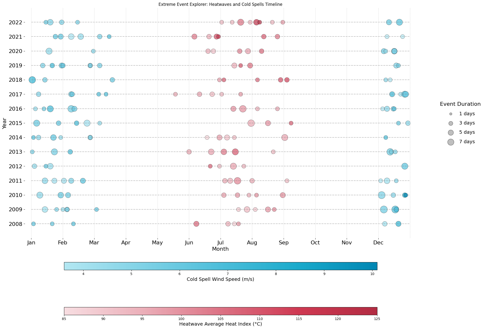
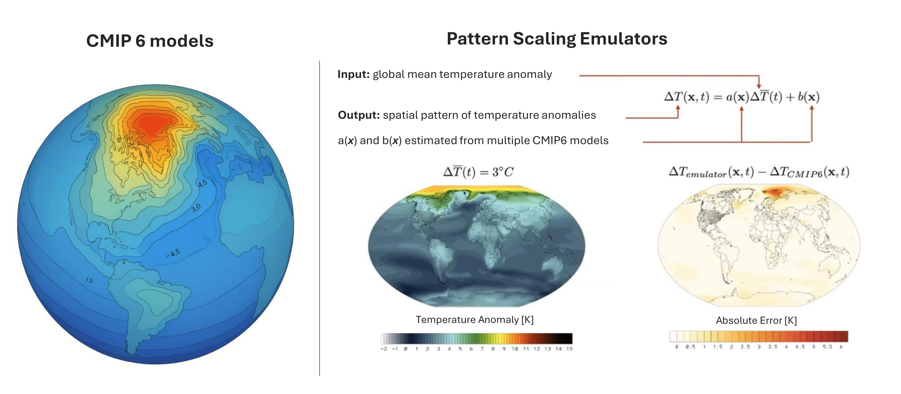
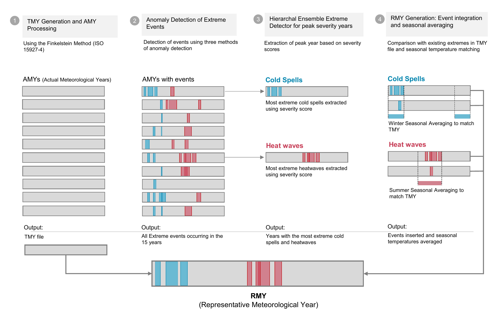
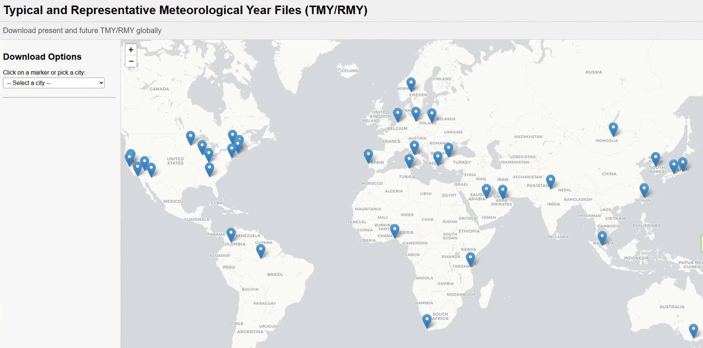
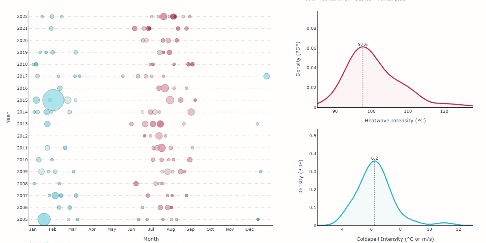

# Extreme-Aware Meteorological Years: Generating RMYs and FRMYs for Climate-Resilient Building Simulations

## Motivation

With the increasing *frequency*, *intensity*, and *duration* of extreme weather events worldwide, traditional simulation inputs no longer capture the conditions most critical to building resilience. TMY (Typical Meteorological Year) weather files represent averaged conditions and hence do not represent the full spectrum of extremes, which are critical to assessing thermal resilience, peak loads, overheating, and grid reliability under climate stress. 

This project adresses that gap by embedding realistic extreme events—both historical and future—into weather files that are fully compatible with building simulation tools like EnergyPlus, ClimateStudio, Rhino/Grasshopper, and more. All data, code, and workflows are open-source, enabling reproducibility and adaptation for global use.

## Key Components

- **RMYs (Representative Meteorological Years):** Weather files embedded with observed extreme events (heatwaves and cold spells), generated from historical AMYs (Actual Meteorological Years) data using anomaly detection.
- **FRMYs (Future Representative Meteorological Years):** Morphed weather files embedding future heatwaves and cold spells derived from climate emulator trajectories with annual resolution and embedded uncertainty.
- **Open-Source Anomaly Detection**: A modular, fully open-source detection framework that identifies climate extremes using an ensemble of methods—static thresholds, Graph Neural Networks (GNNs), and Extreme Value Theory (EVT). The codebase is public and reusable across projects aiming to detect and embed extremes in weather or environmental time-series data.
- **Event Integration in Accessible Weather files:** Temporal smoothing and seasonal averaging logic that inserts extremes while preserving monthly averages in weather files compatible with a wide range of simulation programs. 

## Extreme Events Explorer (EEE)
This timeline shows detected heatwaves and cold spells across years based on the detection algorithm in a sample city:



---

## Methodology

This toolkit introduces a multi-method event detection and integration pipeline for constructing Representative Meteorological Year (RMY) and Future RMY (FRMY) weather files. These new formats restore historically observed or projected extremes into standard TMY files to enable realistic simulation for overheating, thermal resilience, and peak demand.

An Ensemble anomaly-detection method is used based on the following:

- **Static Thresholding:** Identifies extremes based on fixed temperature or percentile thresholds.
- **GNN-Based Anomaly Detection:** Flags events using graph-based representations of temporal temperature anomalies.
- **Extreme Value Theory (EVT):** Extracts statistically rare extremes using Peaks Over Threshold (POT) modeling.

Each method is used in a complementary ensemble to identify the most severe year and characteristic events.

**For FRMY generation**, future extremes are derived from annually-morphed climate emulator outputs that reflect global warming trajectories under different scenarios. These files embed projected heatwaves and cold spells with realistic variability, and are processed using the same anomaly detection and integration methods as RMYs.



## Workflow Summary

1. Detect peak heatwaves and cold spells across 15+ years of EPW files.
2. Match extreme events to base-year dates using overlap logic.
3. Replace those dates with extreme-event days from the most severe year, using smoothing.
4. Rebalance monthly averages by inserting non-extreme days to maintain realism.
5. Output:
   - RMY file with embedded extremes
   - Summary CSVs for heatwaves and cold spells


 


## Folder Structure

```
data/
├── cities/             ← one folder per city (8 US cities included)
│   └── <City>/
│       ├── AMY/        ← AMY EPWs, one per year (the year must be in the file name)
│       └── TMY/        ← exactly one base TMY EPW
├── RMY/                ← published RMY EPWs
└── FRMY/               ← published FRMY EPWs
examples/               ← Google Colab notebook
images/                 ← figures used in this README
rmy/                    ← the Python package
tests/                  ← automated checks
```

---

## Explore the Interactive Map



Click below to explore an interactive dashboard where you can download RMY and FRMY weather files for cities worldwide:

👉 [Explore the Map here](https://svante.mit.edu/~pgiani/buildings/)

---

## Usage

Install required packages:

```bash
pip install -r requirements.txt
```

Then run the following from the repo root:

```python
from rmy import run_full_rmy_pipeline
from rmy.visualization import visualize_extreme_events

rmy_path = run_full_rmy_pipeline("data/cities/Boston/AMY", "data/cities/Boston/TMY", "output/Boston")

visualize_extreme_events("output/Boston/hotspells/heatwave_events.csv",
                         "output/Boston/coldspells/coldspells_events.csv")
```

To use your own city, create a folder with the same layout and run it the same way:

```
data/cities/<YourCity>/AMY/ → AMY EPWs, one per year (the year must be in the file name)
data/cities/<YourCity>/TMY/ → exactly one base TMY EPW
```

Outputs, in the folder given as the third argument:

```
hotspells/                → heat-wave events and yearly statistics
coldspells/               → cold-spell events and yearly statistics
RMY_<TMY file name>.epw   → the RMY weather file
```

## Try it on Google Colab

[](https://colab.research.google.com/github/Nadatarkhan/RMY/blob/main/examples/RMY_Generation_Colab.ipynb)

---
## What's Next?

As climate conditions continue to shift, extreme events are evolving—not just in frequency, but in duration, intensity, and timing. Future extensions of this project will:

- Track how heatwaves and cold spells are shifting across decades
- Link these shifts to building performance risk and urban equity impacts
- Expand the tool to include dual temperature hazard assessments across cities

Below is a preview of how extreme events are changing over time:



Stay tuned for the next phase: ***Extremes in Motion*** — a dynamic, multi-city comparison tool.


## Citations

Tarkhan, N., Crawley, D., Lawrie, L., & Reinhart, C.  
**Generation of representative meteorological years through anomaly-based detection of extreme events.**  
*Journal of Building Performance Simulation, 2025.*  
[https://doi.org/10.1080/19401493.2025.2499687](https://doi.org/10.1080/19401493.2025.2499687)

Giani, P., Fiore, A.M., Flierl, G., et al.␣␣  
**Origin and Limits of Invariant Warming Patterns in Climate Models.**  
*arXiv preprint, 2024.*  
[https://arxiv.org/abs/2411.14183](https://arxiv.org/abs/2411.14183)

Tarkhan, N., & Reinhart, C.  
**Representing Climate Extremes: An Event-driven Approach to Urban Building Performance Assessments.**  
*Comfort at the Extremes Conference, Seville, 2024.*  
[View PDF](https://drive.google.com/file/d/14Kj9-jcL_SQGUaTvbdAzLVPOJHHWHLz0/view?usp=sharing)

---

## License

This repository is released under the MIT License.
